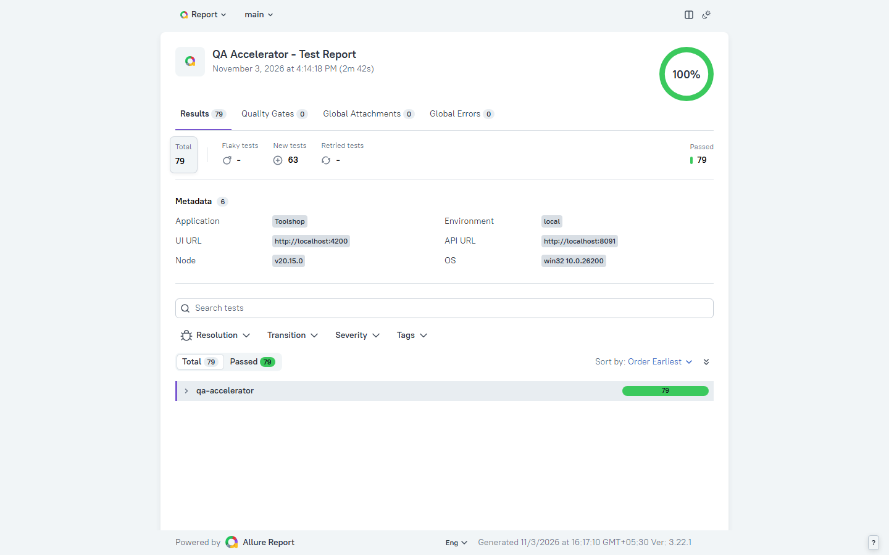
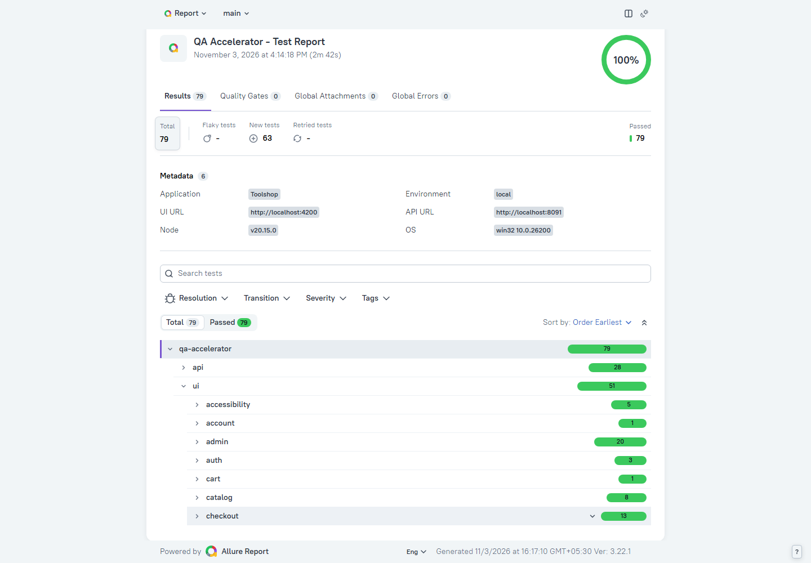
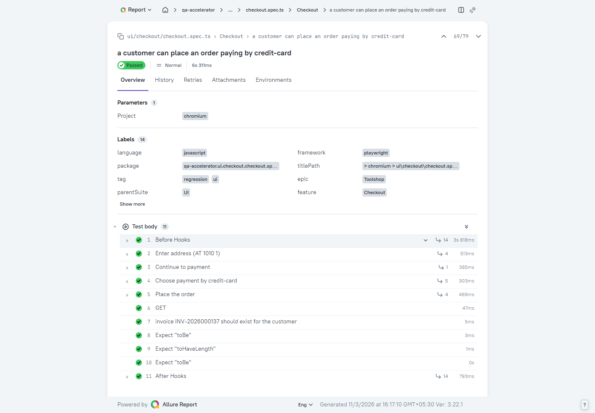

# QA Accelerator

A Playwright + TypeScript starting point for end-to-end test automation. It covers UI and API testing in one
project, keeps test data clean after itself, and produces reports you can hand to a client or a team lead.

I built it as a working example of how I set up automation on a new project, and I use it as the base for
client work. To keep it honest, it runs against a real open-source shop, [Toolshop](https://github.com/testsmith-io/practice-software-testing),
rather than a toy login page. Swapping in your own application is mostly a matter of replacing the page
objects and API clients (see "Using it on your own application" below).

[](https://github.com/devbyanoop/qa-accelerator/actions/workflows/playwright.yml)
[](https://devbyanoop.github.io/qa-accelerator/)



| Tests grouped by area                       | A single test, step by step                               |
| ------------------------------------------- | --------------------------------------------------------- |
|  |  |

## What it does

You can browse the report from the latest run on `main` without installing anything:
[devbyanoop.github.io/qa-accelerator](https://devbyanoop.github.io/qa-accelerator/).

There are 86 tests by default and 89 if you switch on the visual checks, plus 3 phone-sized ones you can run
separately. Three of the 86 read the application's database and are skipped unless you point them at it. Each one is tagged, so you can run
only the slice you care about.

- **Authentication:** login, wrong password, and protected pages bouncing anonymous visitors.
- **Catalog:** search, sorting and pagination, checked in the browser and against the API.
- **Cart and checkout:** adding to the cart, all five payment methods, address and payment validation, and
  signing in halfway through checkout. Every order is confirmed through the invoices API, not just by what
  the page says.
- **API contract:** the shape of the product, product list and login responses, so a renamed field or a
  changed type is caught with a clear message.
- **Database:** what the application actually stored: an order with its items and payment, a user with a
  hashed password, and a deleted product's row gone.
- **Access control:** admin-only endpoints must answer 401 to anonymous users, 403 to customers and 200 to
  admins.
- **Payment rules:** each validation rule of the payment check, valid and invalid input.
- **Admin area:** dashboard, brands, products, users and orders, including create, edit, delete and
  validation.
- **Accessibility:** axe-core scans of the main pages against WCAG 2.1 A/AA. The full result is attached to
  the report.
- **Visual:** screenshot comparison of a few static components (login form, registration form, navigation).
- **Mobile:** the catalog, search and sign-in on a phone-sized screen (Pixel 7 profile).

## Running it locally

You need Node.js 20 or newer and Docker. Ports 4200 and 8091 have to be free.

```
git clone https://github.com/devbyanoop/qa-accelerator.git
cd qa-accelerator
npm ci
npx playwright install chromium
cp .env.example .env.local
npm run app:start
npm test
```

On Linux, install the browser with `npx playwright install --with-deps chromium` instead.

`npm run app:start` starts Toolshop in Docker, loads its test data and waits until it responds. The first run
downloads the images, so give it a few minutes. When you are done, `npm run app:stop` removes the containers
and their data.

A few things worth knowing:

- **Credentials.** Toolshop publishes demo accounts (one customer, one admin) in its own README. Copy them
  into `.env.local` as `CUSTOMER_EMAIL`, `CUSTOMER_PASSWORD`, `ADMIN_EMAIL` and `ADMIN_PASSWORD`. The file is
  git-ignored.
- **Run on the Docker machine.** The Toolshop front end calls its API at `localhost:8091`, so the tests have
  to run on the same machine as Docker, or you need to forward both ports to yours.
- **Linux and arm64.** One of the Toolshop images is arm64-only. On a Linux host, enable emulation once with
  `docker run --privileged --rm tonistiigi/binfmt --install arm64`. Docker Desktop already has it.
- **No source code needed.** The app runs from images pinned by digest in `infra/toolshop/docker-compose.yml`,
  so results stay repeatable.

### Database checks

The tests in `tests/db` read the application's MariaDB directly, for things the screen and the API can't prove,
such as whether a password is stored hashed. They are read-only. To run them locally, uncomment the `DB_` lines
in `.env.local` (they match the containers that `npm run app:start` creates, and the database port is published
on `127.0.0.1:3307` only). Without `DB_HOST` they are skipped. CI sets it, so they always run there.

## Choosing what to run

```
npm run test:smoke                  # quick check of the critical paths
npm run test:regression             # the wider suite
npx playwright test --grep @api     # API tests only
npx playwright test --grep @a11y    # accessibility only
```

| Tag            | Meaning                                                          |
| -------------- | ---------------------------------------------------------------- |
| `@smoke`       | critical paths, meant to run on every change                     |
| `@regression`  | the wider suite                                                  |
| `@api`, `@ui`  | which layer the test works at                                    |
| `@a11y`        | accessibility scans                                              |
| `@visual`      | screenshot comparison, only runs when `VISUAL=true`              |
| `@known-issue` | records a bug in the application, written as an expected failure |

To point at another environment, use `TEST_ENV=qa npm test`, which loads `.env.qa`. If your machine struggles
with parallel browsers, cap them with `WORKERS=2`.

### Other browsers

Everyday runs use Chromium. For Firefox and WebKit too:

```
npx playwright install firefox webkit
BROWSERS=chromium,firefox,webkit npm test
```

On Windows PowerShell, set the variable first: `$env:BROWSERS='chromium,firefox,webkit'`. The nightly CI run
does this for you.

For the phone-sized checks use `BROWSERS=mobile-chrome npm test`. That project runs only the specs in
`tests/ui/mobile`, since the rest of the suite is written for a desktop layout. The nightly run includes it.

## Visual checks

Screenshot baselines depend on the operating system's fonts, so I generate them inside the Linux runner image
and only run the visual tests on request. Running them in the container is what matches CI:

```
docker build -t qa-accelerator-runner .
docker run --rm --init --ipc=host --network host --env-file .env.local -e VISUAL=true \
  qa-accelerator-runner tests/ui/visual
```

After an intended UI change, refresh the baselines and look over the changed images before committing:

```
docker run --name qa-visual --init --ipc=host --network host --env-file .env.local -e VISUAL=true \
  qa-accelerator-runner tests/ui/visual --update-snapshots
docker cp qa-visual:/app/tests/ui/visual/__screenshots__ tests/ui/visual/
docker rm qa-visual
```

Only static components are compared, so the result doesn't depend on data that other tests are changing.

## Running in a container

If you don't want Node or browsers installed on the machine, the `Dockerfile` builds a runner image with
everything in it. The application still has to be running, and on a Linux host:

```
docker build -t qa-accelerator-runner .
docker run --rm --init --ipc=host --network host --env-file .env.local qa-accelerator-runner --grep @smoke
```

`--network host` lets the browser inside the container reach the app on the host's `localhost`.

## Reports

Each run writes an [Allure 3](https://allurereport.org) results folder next to Playwright's own HTML report.
Allure 3 runs on Node, so there's no Java to install.

```
npm test                  # runs the suite, writes allure-results/ and playwright-report/
npm run report:allure     # builds and opens the Allure report
npm run report            # opens Playwright's HTML report (traces, video, screenshots)
```

Tests are labelled automatically: the application name, whether it is an API or UI test, the feature (taken
from the `describe` title) and a severity (`@smoke` counts as critical). Page-object actions show up as named
steps, and the report header lists the environment, URLs, Node version and OS.

## Continuous integration

The workflow in `.github/workflows/playwright.yml` runs on pushes to `main`, on pull requests, nightly, and on
demand.

1. The **quality** job runs lint, type checking and a format check.
2. The **e2e** job starts its own copy of Toolshop on the runner with `npm run app:start`, runs the suite,
   then the visual checks as an advisory step (a mismatch is reported but doesn't fail the build). It uploads
   the Playwright report, the Allure report and the traces, videos and JUnit file as artifacts for 14 days.
   Pushes and pull requests use Chromium. The nightly run, or a manual run with "all browsers" ticked, adds
   Firefox, WebKit and the phone-sized Chrome.
3. The optional **publish-report** job puts the Allure report on GitHub Pages.

Because every run starts its own application, CI doesn't depend on anyone's laptop or Docker host.

To set it up on your own fork:

- Add four repository secrets: `CUSTOMER_EMAIL`, `CUSTOMER_PASSWORD`, `ADMIN_EMAIL` and `ADMIN_PASSWORD`.
- For the report site, set Pages to the "GitHub Actions" source and add a repository variable
  `PUBLISH_REPORT=true`. Trend history is kept between runs with the Actions cache.

Nothing here is tied to GitHub. On any other CI system with Docker, run `npm run app:start`, then
`npx playwright test` (or use the runner image). JUnit results go to `test-results/junit.xml`.

## Bugs found in Toolshop

Testing the app turned up some real defects. Each one is written as a `@known-issue` test with the correct
expectation, marked as an expected failure. While the bug exists the test counts as a pass, and the day the
bug is fixed it fails, which is the cue to delete the tag.

| Area               | What's wrong                                                                                         |
| ------------------ | ---------------------------------------------------------------------------------------------------- |
| Admin brands       | search results are cached for an hour and not cleared on delete, so a deleted brand keeps showing up |
| Payment check      | an unsupported payment method is accepted as "Payment was successful"                                |
| Admin edit product | the form doesn't pre-fill stock, brand, category or image, so any edit means re-entering them        |
| Admin add user     | leaving "failed login attempts" and "enabled" blank makes the server answer 500                      |
| Orders             | an order is created for a cart with no items                                                         |
| Accessibility      | a button on the login page has no accessible name (axe `button-name`, critical)                      |

The accessibility tests also keep a baseline of violations the app already has, and only fail on new ones.

## Keeping dependencies current

Dependabot opens weekly updates for npm packages, GitHub Actions and the Dockerfile. I left Playwright out
on purpose, because three things have to change together: `@playwright/test` in `package.json`, the image tag
in the `Dockerfile` (`mcr.microsoft.com/playwright:v<version>-noble`) and the visual baselines. The Toolshop
images in `infra/toolshop/docker-compose.yml` are pinned by digest, and the file explains how to bump them.

## Using it on your own application

The full, step-by-step version is in [docs/adapting-to-your-application.md](docs/adapting-to-your-application.md). In short:

1. Add a `.env.<profile>` file for each of your environments.
2. Replace the contents of `src/pages`, the domain clients in `src/api` and `src/data` with your own.
3. Leave `src/config`, `src/fixtures/base.fixture.ts` and `src/utils` alone. They are application-agnostic.

[ARCHITECTURE.md](ARCHITECTURE.md) explains how the pieces fit together and [CONTRIBUTING.md](CONTRIBUTING.md)
covers conventions for new tests. For the story behind the project, see the [case study](docs/case-study.md).

## About

Built by [devbyanoop](https://github.com/devbyanoop), a test automation engineer with 17+ years in the field.
I take on freelance automation work, from framework design to getting a team's suite running reliably in CI.

## License

MIT
